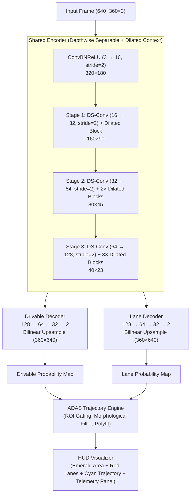
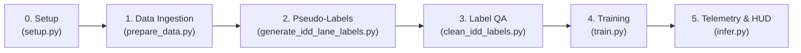

# TwinDrive: Multi-Domain Real-Time ADAS via TwinLiteNet

[](https://www.python.org/)
[](https://pytorch.org/)
[](https://developer.nvidia.com/cuda-zone)
[](https://www.nvidia.com/en-us/autonomous-machines/embedded-systems/)
[](LICENSE)

**TwinDrive** is a lightweight, real-time Advanced Driver Assistance System (ADAS) for dual-task perception: **Drivable Area Detection** and **Lane Line Segmentation**. 

Designed for low-power edge platforms (e.g., NVIDIA Jetson Nano), TwinDrive extends the original **TwinLiteNet** architecture to robustly operate across **structured highways (BDD100K)** and **unstructured, unmarked Indian road environments (IDD Lite)**. Beyond raw segmentation masks, TwinDrive incorporates a full geometric **ADAS Trajectory Engine** that computes vehicle lateral offset, trajectory curves, and real-time HUD telemetry.

---

## Table of Contents

- [Key Highlights & Innovations](#key-highlights--innovations)
- [System Architecture](#system-architecture)
- [Repository Structure](#repository-structure)
- [Pipeline & Workflow](#pipeline--workflow)
- [Installation & Setup](#installation--setup)
- [Usage Guide](#usage-guide)
  - [1. Data Preparation](#1-data-preparation)
  - [2. IDD Pseudo-Label Generation & QA](#2-idd-pseudo-label-generation--qa)
  - [3. DataLoader Integrity & Sanity Test (Optional)](#3-dataloader-integrity--sanity-test-optional)
  - [4. Model Training](#4-model-training)
  - [5. ADAS Inference & Telemetry HUD](#5-adas-inference--telemetry-hud)
- [Comparison: TwinDrive vs. Base TwinLiteNet](#comparison-twindrive-vs-base-twinlitenet)
- [What Has to Be Done (Roadmap & Action Plan)](#what-has-to-be-done-roadmap--action-plan)

---

## Key Highlights & Innovations

1. **Lightweight Shared-Encoder / Dual-Decoder Network**:
   - Uses **Depthwise-Separable Convolutions** and **Dilated Context Blocks** (dilation rates $r \in \{1, 2, 4, 8\}$) to capture broad visual context without heavy FLOP overhead.
   - Dual decoders independently predict drivable areas and lane markings with bilinear upsampling (eliminating transposed convolution checkerboard artifacts).

2. **Mixed-Domain Multi-Task Supervision**:
   - Trained on both **BDD100K** (US driving) and **IDD Lite** (Indian driving conditions with unmarked edges, dirt shoulders, and chaotic traffic).
   - Solves the absence of ground-truth lane annotations in IDD Lite using a **hybrid teacher (YOLOP) + OpenCV morphological pipeline** with strict geometric QA.

3. **Domain-Gated Loss Formulation (`TwinLiteLoss`)**:
   - Combines BCE and Dice Loss with sample-level gating: IDD frames without valid lane markings contribute **zero** lane gradient, preventing false-negative penalization.
   - Implements class reweighting (`pos_weight = 3.0` and `1.5×` Dice weighting) to handle extreme lane-pixel sparsity.

4. **Production-Ready ADAS Trajectory Engine**:
   - Rejects sky/glare artifacts via dynamic ROI masking (bottom 55% frame).
   - Identifies the ego-vehicle's active drivable corridor and fits 1st/2nd-degree polynomials to lane boundaries.
   - Features an **Unmarked Corridor Fallback** mode that derives guidance trajectory directly from drivable area boundaries when lane markings are missing.
   - Computes lateral displacement in centimeters, turn direction, and FPS overlay.

---

## System Architecture



---

## Repository Structure

```text
project/
├── README.md                           # Comprehensive project documentation & guide
├── setup.py                            # Environment verification & folder scaffolding
├── base_paper/                         # Original TwinLiteNet reference implementation
│   ├── model/TwinLite.py               # Original ESPNet-C based model
│   ├── dataset.py                      # Original single-domain BDD100K loader
│   ├── utils.py                        # Original evaluation & loss functions
│   └── const.py                        # Default paths and hyperparameter constants
├── data/
│   ├── raw/                            # Source downloaded datasets
│   │   ├── bdd100k_images_10k/         # BDD100K 10K raw RGB frames
│   │   ├── bdd100k_drivable_maps/      # BDD100K drivable ground truth masks
│   │   ├── bdd_lane_gt/                # BDD100K lane line ground truth masks
│   │   ├── bdd_seg_gt/                 # BDD100K semantic segmentation masks
│   │   └── idd20k_lite/                # IDD Lite raw images & drivable labels
│   └── processed/                      # Preprocessed, 640×360 paired dataset
│       ├── train/
│       │   ├── images/                 # Normalized RGB frames (bdd100k_* & idd_lite_*)
│       │   ├── masks_drivable/         # Binary drivable masks (0 or 255)
│       │   └── masks_lanes/            # Binary lane masks (GT or verified pseudo-labels)
│       └── val/
│           ├── images/
│           ├── masks_drivable/
│           └── masks_lanes/
└── twin/                               # Core TwinDrive ADAS codebase
    ├── src/
    │   ├── models/
    │   │   └── twinlitenet.py          # TwinLiteNet architecture (DS-Conv + DilatedContext)
    │   ├── utils/
    │   │   ├── dataset.py              # Multi-domain Dataset with environmental augmentations
    │   │   ├── prepare_data.py         # Ingestion, resizing, and pairing pipeline
    │   │   ├── generate_idd_lane_labels.py # YOLOP + OpenCV pseudo-labeling for IDD
    │   │   └── clean_idd_labels.py     # Label QA filter (pixel density & component gate)
    │   ├── postprocess/
    │   │   └── trajectory.py           # Geometry pipeline, contour filtering & polyfit
    │   ├── train.py                    # Multi-task training with domain-gated loss
    │   └── infer.py                    # Batch inference, ADAS trajectory & HUD output
    ├── weights/
    │   ├── best_model.pth              # Best checkpoint (validated via validation loss)
    │   └── latest_model.pth            # Most recent epoch checkpoint
    └── outputs/
        └── predictions/                # Rendered HUD frames with ADAS telemetry
```

---

## Pipeline & Workflow



1. **Setup (`setup.py`)**: Checks CUDA availability, GPU capability, and automatically scaffolds folder directories.
2. **Data Ingestion (`prepare_data.py`)**: Standardizes raw BDD100K and IDD Lite images to `640×360`, binarizes drivable/lane masks, and prepends dataset prefixes.
3. **Pseudo-Labeling (`generate_idd_lane_labels.py`)**: Computes pseudo-lane annotations for IDD Lite by fusing YOLOP neural structural lane outputs with OpenCV Top-Hat + HLS color filtering.
4. **Label QA (`clean_idd_labels.py`)**: Filters pseudo-labels by rejecting over-dense masks (>6,000 px) or scattered fragments (>8 connected components). Unusable masks are zeroed out so `lane_valid=0`.
5. **Training (`train.py`)**: Trains `TwinLiteNet` using mixed precision (AMP), Cosine Annealing scheduler, and `TwinLiteLoss` with domain gating.
6. **Inference & Telemetry (`infer.py`)**: Feeds camera frames through the model, computes trajectory curves and lateral displacement in `trajectory.py`, and renders the HUD overlay.

---

## Installation & Setup

### 1. Prerequisites
- Python 3.10+ (Virtual environment recommended)
- NVIDIA GPU with CUDA support (e.g., RTX 2050 / RTX 3060+ or Jetson Xavier/Orin)

### 2. Environment Setup
```bash
# Clone or navigate to the workspace
cd project

# Activate virtual environment
# Windows:
.venv\Scripts\activate
# Linux / macOS:
source .venv/bin/activate

# Install dependencies
pip install torch torchvision --index-url https://download.pytorch.org/whl/cu118
pip install opencv-python albumentations tqdm numpy matplotlib
```

### 3. Verify Environment & Folder Scaffold
```bash
python setup.py
```
This tests PyTorch CUDA execution and verifies all necessary input/output directories.

---

## Usage Guide

### 1. Data Preparation
Format raw datasets into unified `640×360` paired masks:
```bash
python twin/src/utils/prepare_data.py
```

### 2. IDD Pseudo-Label Generation & QA
Generate lane pseudo-labels for IDD Lite and run automated QA:
```bash
# Step A: Run hybrid YOLOP + morphological labeling
python twin/src/utils/generate_idd_lane_labels.py

# Step B: Prune false positives and noisy lane masks
python twin/src/utils/clean_idd_labels.py
```

### 3. DataLoader Integrity & Sanity Test (Optional)
Before starting training, you can verify that the processed dataset, augmentations, and domain flags load correctly:
```bash
python twin/src/utils/dataset.py
```
*Note: `dataset.py` does not modify or generate dataset files; it is an importable `torch.utils.data.Dataset` class used directly by `train.py`. Running it standalone runs a test batch inspection to confirm tensor shapes and active lane annotations.*

### 4. Model Training
Train the multi-task network with Cosine Annealing and domain-gated loss:
```bash
python twin/src/train.py
```
*Key training configurations inside `train.py`:*
- `additional_epochs`: Number of epochs to train.
- `batch_size`: Default is 8 (adjust based on VRAM).
- `learning_rate`: Default `1e-4` with cosine decay to `1e-5`.
- `resume_checkpoint`: Path to resume weights (e.g., `"twin/weights/latest_model.pth"`).
- `reset_best_loss`: When fine-tuning, resets best validation loss tracking.

### 5. ADAS Inference & Telemetry HUD
Run batch inference and generate HUD visualizations with trajectory telemetry:
```bash
# Run on 15 validation images (mix of BDD100K and IDD Lite)
python twin/src/infer.py --source data/processed/val/images --samples 15

# Run specifically on BDD100K samples
python twin/src/infer.py --source data/processed/val/images --bdd-only --samples 10

# Adjust lane detection confidence threshold (default: 0.50)
python twin/src/infer.py --lane-thresh 0.45 --samples 20
```
Output annotated frames will be saved in `twin/outputs/predictions/`.

---

## Comparison: TwinDrive vs. Base TwinLiteNet

| Dimension | Base TwinLiteNet (`base_paper/`) | TwinDrive (`twin/`) |
|---|---|---|
| **Encoder Architecture** | ESPNet-C (5-way dilated convs with Hierarchical Feature Merging + raw RGB projection) | **Depthwise-Separable Convolutions + 4-way DilatedContextBlocks** (Rates 1, 2, 4, 8) |
| **Upsampling Method** | Transposed Convolutions (`ConvTranspose2d`) | **Bilinear Interpolation (`nn.Upsample`)** — zero checkerboard artifacts |
| **Output Channels** | Single-channel binary logit per head (`squeeze(-1)`) | **Two-channel classification logits** (`[B, 2, H, W]`) with differential backpropagation |
| **Data Scope** | Single domain (BDD100K only, US highway/urban) | **Dual domain (BDD100K + IDD Lite)** for mixed structured and unstructured roads |
| **Loss Supervision** | Basic BCE + Dice applied equally across all images | **Domain-Gated Loss**: sample-level masking of IDD lanes to avoid negative penalization |
| **Class Imbalance** | Standard unweighted BCE | **Positive-weighted BCE (`pos_weight=3.0`) + 1.5× weighted Dice** |
| **Augmentation Pipeline** | Standard geometric warps (affine, crop, horizontal flip) | **Adverse environmental simulation** (rain, sun glare, motion blur, contrast adjustment) |
| **Application Layer** | Raw mask segmentation only | **Complete ADAS pipeline**: ROI gating, polynomial trajectory curve fitting, lateral offset calculation, and HUD overlay |

---

## What Has to Be Done (Roadmap & Action Plan)

The following structured tasks are planned or required to bring the TwinDrive project from the prototype stage to an edge-deployed production system:

### 1. Formal Quantitative Evaluation & Benchmarking
- [ ] **Standard Metric Evaluation Script**:
  - Implement an evaluation script (`evaluate.py`) that computes standard ADAS benchmarks across the validation set:
    - **Drivable Area**: mIoU, Accuracy, F1-Score.
    - **Lane Line Detection**: mIoU, Accuracy, Precision, Recall, and F1-Score.
- [ ] **Ablation Studies**:
  - Quantify performance gains comparing:
    - Standard training (BDD100K only) vs. Mixed-Domain (BDD100K + IDD Lite).
    - Unweighted Loss vs. Weighted BCE + Dice.
    - Base ESPNet-C encoder vs. Depthwise-Separable DilatedContext encoder.

### 2. Video Stream & Real-Time Camera Inference
- [ ] **Live Video Processing**:
  - Extend `infer.py` to accept `.mp4`/`.avi` video files and live video streams (`/dev/video0` or RTSP IP cameras).
- [ ] **Temporal Smoothing (Anti-Jitter)**:
  - Add an **Exponential Moving Average (EMA)** or **Kalman Filter** across consecutive frames for:
    - Polynomial coefficients ($a, b, c$).
    - Vehicle lateral offset distance.
  - This prevents high-frequency visual flicker in the cyan trajectory overlay during video playback.

### 3. Edge Optimization & Hardware Deployment
- [ ] **ONNX Model Export**:
  - Create `export_onnx.py` to convert `twinlitenet.py` into an optimized static ONNX computational graph (`input: 1x3x360x640`).
- [ ] **TensorRT Quantization (FP16 / INT8)**:
  - Compile the ONNX model using NVIDIA TensorRT for target deployment on **Jetson Nano / Xavier / Orin**.
  - Calibrate INT8 quantization using a subset of validation frames.
- [ ] **Latency & Power Profiling**:
  - Benchmark inference latency (target: $\ge 30\text{ FPS}$ on Jetson Nano), VRAM consumption, and thermal footprint.

### 4. Enhanced ADAS Trajectory Corner-Case Handling
- [ ] **Obstacle & Dynamic Agent Masking**:
  - Incorporate bounding box suppression (from an object detector or segmenter) to prevent vehicle tails/pedestrians from corrupting the drivable area corridor contour.
- [ ] **Adaptive Horizon / Pitch Compensation**:
  - Automatically detect the camera vanishing point / horizon line rather than using a static ROI cutoff (bottom 55%), adapting to vehicle uphill/downhill pitch.
- [ ] **Lane Departure Warning (LDW) State Machine**:
  - Add visual/audible trigger warnings in HUD when `abs(offset_cm) > threshold` or when crossing a lane boundary without a turn signal indication.

---

## Authors & Acknowledgments

- **Authors**: [Aadinarayan R](https://github.com/ChaChaEatsFruits), [Govind nair](https://github.com/GT4933), [Shreyas N](https://github.com/ShreyasNishanth)
- **Base Architecture Reference**: [TwinLiteNet: An Efficient and Lightweight Model for Driveable Area and Lane Detection](https://github.com/chequanghuy/TwinLiteNet)
- **Datasets**:
  - [BDD100K: A Diverse Driving Dataset for Heterogeneous Multitask Learning](https://www.bdd100k.com/)
  - [AutoNUE IDD: India Driving Dataset (IDD Lite)](https://idd.insaan.iiit.ac.in/)
